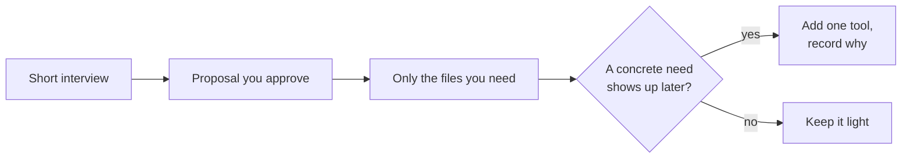

# pmkit

**Project setup for AI coding agents: a short interview, only the files you'll keep up.**

[](LICENSE)
[](https://github.com/Shanmuga-Raja-Portfolio/Project-Management_template/actions/workflows/ci.yml)
[](CODE_OF_CONDUCT.md)
[](https://shanmuga-raja-portfolio.github.io/Project-Management_template/)

**Docs site:** [shanmuga-raja-portfolio.github.io/Project-Management_template](https://shanmuga-raja-portfolio.github.io/Project-Management_template/) ·
**Fastest start:** paste the [Level 1 RUNFILE](levels/1-starter/RUNFILE.md) into any chat and answer the questions.

pmkit sets up a project folder for your AI agent or chat model. It asks a few questions, shows you a proposal, and creates only the files you approve. Tools are optional and added later, only when a real need shows up.

Status: v0.1.1, early. Parts we have not tested are labelled "untested" or "unverified".



## Who it is for

- **A solo person or single owner** running an AI agent on a folder of code, research or writing: Claude Code, OpenCode, Cursor, GitHub Copilot agent mode, Codex, Gemini CLI, Aider and similar.
- **Browser chat users** (ChatGPT, Claude.ai, Gemini) need only `PROJECT.md`, `STATUS.md` and `RULES.md`. See [guides/chat-window.md](guides/chat-window.md).
- **Not yet (planned for v0.2):** teams editing the same files on parallel branches, and large document-compliance pipelines.

## What you get

- An instruction file for your agent (`AGENTS.md`), short working rules (`RULES.md`), a project brief (`PROJECT.md`), a status file (`STATUS.md`) and a record of setup choices (`SETUP_DECISIONS.md`).
- Only if you want them: a decision log, a work log and a knowledge folder.
- Tool cards for third-party tools, and opt-in installers that ask before every step.
- Or nothing extra: "use no tools" is a valid outcome. More on scope: [guides/what-this-is-not.md](guides/what-this-is-not.md).

## Pick your level

Every level starts with an interview. If you are unsure, pick Level 1; you can add tools later. [START-HERE.md](START-HERE.md) helps you choose.

| Level | Suits | What you get | Time (approx.) |
|---|---|---|---|
| [1. Starter](levels/1-starter/README.md) | Most people. The safe default. | Eight short questions. Only the files your answers need. No tools. | 5-15 min |
| [2. Starter + tools](levels/2-starter-tools/README.md) | Code or document-heavy projects | Level 1, plus questions on budget, hardware, existing text and past problems. Opt-in installers for light tools. | 15-40 min |
| [3. Interview-led](levels/3-interview/README.md) | Larger projects, handoffs, inherited repos | The full interview. A written plan only, or a plan plus files. Service-layer tools as guided manual steps. Bring your own tool for review. | 30-60 min |

## Quick start

### Option A: paste a RUNFILE into any LLM

No git, Python or terminal needed. Each level has one self-contained prompt for ChatGPT, Gemini, Claude, a local model or any other chat LLM.

1. Open the RUNFILE for your level: [Level 1](levels/1-starter/RUNFILE.md) (about 7k tokens), [Level 2](levels/2-starter-tools/RUNFILE.md) (about 15k) or [Level 3](levels/3-interview/RUNFILE.md) (about 21k).
2. On GitHub, use "Copy raw file" (or click "Raw" and copy all), then paste it into a new chat.
3. Answer the questions. An agent with folder access creates the files; otherwise the model prints each file for you to save.

On a local model, please check the context window first ([Local models](#local-models)).

### Option B: Claude Code skill

macOS / Linux / Git Bash, from anywhere:

```bash
git clone https://github.com/Shanmuga-Raja-Portfolio/Project-Management_template.git
cd Project-Management_template
bash scripts/install-skill.sh                     # installs to ~/.claude/skills
# or: bash scripts/install-skill.sh --project /path/to/your/project
```

Windows PowerShell:

```powershell
powershell -ExecutionPolicy Bypass -File scripts\install-skill.ps1
# or: ... scripts\install-skill.ps1 -Project C:\path\to\your\project
```

Then, in your project, say "set up this project" or run `/project-setup`. The skill shows you the file list before it creates anything. Later, say "add a tool" and it follows [guides/adding-tools-mid-project.md](guides/adding-tools-mid-project.md).

<details>
<summary>How this fits with Claude Code's own <code>CLAUDE.md</code></summary>

- Your instructions live in `AGENTS.md`; `CLAUDE.md` is a short generated file that imports it.
- If Claude Code adds lines to `CLAUDE.md`, move them into `AGENTS.md` and run `python .pmkit/pmkit.py sync --force`.

More detail: [Level 1 README](levels/1-starter/README.md#keeping-the-folder-tidy).

</details>

### Option C: copy the starter files yourself

macOS / Linux / Git Bash, from the repo root of a clone:

```bash
bash scripts/new-project.sh --minimal /path/to/your/project
# or: bash scripts/new-project.sh --only AGENTS.md,RULES.md,PROJECT.md,STATUS.md,SETUP_DECISIONS.md /path/to/your/project
```

Windows PowerShell:

```powershell
powershell -ExecutionPolicy Bypass -File scripts\new-project.ps1 -Minimal C:\path\to\your\project
```

`--minimal` copies the five core files, `.gitignore` and `.pmkit/`. No flag copies the whole starter folder. Existing files are never overwritten. What each file is for: [template/README.md](template/README.md).

## How the layers work

Layers describe how heavy something is to run. Levels describe how long the interview is.

| Layer | What it is | Members | Default |
|---|---|---|---|
| **Method** | File conventions. Nothing to install. | `AGENTS.md`, `RULES.md`, status and decision files, an append-only log, a knowledge folder, stage folders | Yes, sized by the interview |
| **Tool** | Local install. Writes files. No background service. | Archify, graphify (code-only), Open Code Review (delegation mode), LangExtract. Diagram fallback: workflow-graph (draws DAGs; does not run workflows) | No. Add on a trigger |
| **Service** | Database, Docker, API keys, network, or active risk | Strix, cloud backends of Tool-layer tools | No. Trigger plus privacy and budget check |

1. Start with the Method layer. Your answer on upkeep caps how many files and tools you get.
2. Add a tool only when a concrete trigger holds now ([guides/adding-tools-mid-project.md](guides/adding-tools-mid-project.md)).
3. Record each tool decision, with its trigger and a revisit date, in `SETUP_DECISIONS.md`.
4. Remove tools that did not pay off.

The Method layer builds on ICM (stage folders), OKF v0.2 (the knowledge folder) and the Procedural Graphs paper (pitfall notes on stage handoffs). Cards: [catalog/](catalog/README.md). Sources and licenses: [CREDITS.md](CREDITS.md).

## Local models

Any capable LLM can run the interview. Nothing is sent to a cloud model unless you say it may. A local model (Ollama or LM Studio) is the privacy option, but it is less capable than frontier models:

- **Context size.** Ollama's default is small. Set `num_ctx` to at least 16k for Level 1, more for Levels 2 and 3. Each RUNFILE asks the model to quote its first and last headings so you can spot a cut-off.
- **The `/v1` URL suffix differs per tool.** Getting it wrong is the most common failure.
- **Tool calls and agent loops are unreliable** on small models (roughly below 30B parameters).

Setup and smoke tests: [guides/local-models.md](guides/local-models.md). To see what is running: `bash levels/2-starter-tools/installers/check-local-model.sh` (or `check-local-model.ps1` on Windows).

## Privacy

- Every tool card lists the network calls a tool makes and the files it touches, because some tools send data or reuse your keys by default.
- Installers write a privacy-safe env example to `./.pmkit/env/<tool>.env.example`. They never ask for or store API keys.
- Papers and web pages an agent reads are treated as data, never as instructions. More in [guides/privacy-and-network.md](guides/privacy-and-network.md).

## Repo map

| Path | What is there |
|---|---|
| [START-HERE.md](START-HERE.md) | A few questions that pick your level |
| [levels/](levels/) | One folder per level: README and RUNFILE; Level 2 adds installers |
| [interview/](interview/) | Questions, answer-to-recommendation rules, output formats, interview conduct |
| [template/](template/) | Starter files, including `.pmkit/pmkit.py` (sync, check, prune, log, decide) |
| [catalog/](catalog/README.md) | One card per tool, plus a card template |
| [guides/](guides/) | Chat window, overlaps, local models, adding tools, bring your own tool, privacy, what this is not |
| [skill/project-setup/](skill/project-setup/SKILL.md) | The Claude Code skill |
| [scripts/](scripts/) | `new-project`, `install-skill`, `build_runfiles.py` |
| [CONTRIBUTING.md](CONTRIBUTING.md), [CHANGELOG.md](CHANGELOG.md), [CREDITS.md](CREDITS.md) | How to help, what changed, who we build on |

RUNFILEs are generated by `scripts/build_runfiles.py`, so please do not edit them by hand ([how to rebuild](CONTRIBUTING.md#generated-files)).

## Disclaimer

This kit recommends third-party tools. It does not own or vouch for them, and is not affiliated with any of them. Read each tool card and the upstream README before installing, and check what leaves your machine. Security testing tools (e.g. Strix) may only be used on systems you own or have written permission to test. No warranty (MIT).

## Credits and license

pmkit builds on other people's work and is independent of all of it: see [CREDITS.md](CREDITS.md). Released under the [MIT License](LICENSE).
